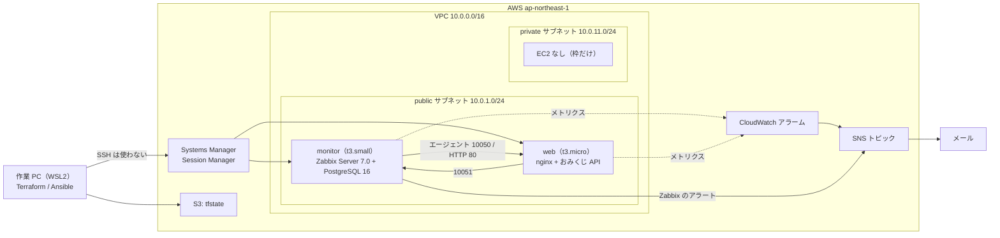
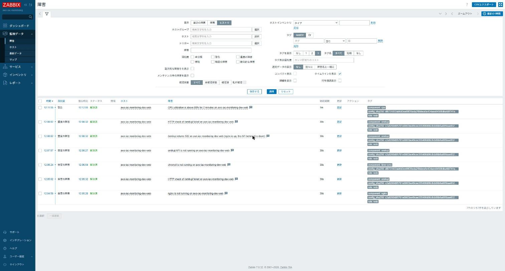

# aws-iac-monitoring

AWS 上の小さな環境を **Terraform** で作り、**Ansible** で設定し、**Zabbix と CloudWatch** で監視して、**わざと障害を起こして検知と復旧を確かめた**リポジトリです。

> **個人の学習・検証用のプロジェクトです。本番運用の実績ではありません。**
> 書いてあることは、すべて自分の AWS アカウントの検証環境で実際に動かして確認したものです。動かしていないもの・試していないものは、「[今後の課題](#今後の課題やっていないこと)」と各文書の「実施していないこと」に分けて書いています。

- 監視の見どころ: [障害注入テストの結果](docs/fault-injection.md)
- 壊れたときの手順: [運用手順書（runbook）](docs/runbook.md)
- 作る途中で止まったことと、その切り分け: [作業記録](docs/work-log.md)

## 構成



図が表示されない場合の説明:

- 作業 PC から、Terraform で AWS のリソースを作り、Ansible で2台の EC2 を設定する。接続は Systems Manager（SSM）だけを使い、SSH は使わない。
- monitor で Zabbix Server が動き、web の nginx とおみくじ API を監視する。
- CloudWatch アラームは、EC2 を外から見る。Zabbix と CloudWatch のアラートは、同じ SNS トピックからメールで届く。

## できること（動かして確認したもの）

| 項目 | 内容 | 確認の方法 |
|---|---|---|
| インフラをコードで作る | VPC、サブネット、セキュリティグループ、EC2 2台、IAM、S3、SNS、CloudWatch アラーム、AWS Budgets | `terraform apply`（計48リソース） |
| SSH なしで運用する | 22番を開けず、鍵も作らない。接続・設定・ポート転送はすべて SSM | `scripts/dev/verify-infra.sh` |
| 設定をコードで入れる | Ansible のロール5つ（common / chrony / zabbix_agent / zabbix_server / web）。動的インベントリ | 2回目の実行で `changed=0` |
| 監視設定もコードで入れる | Zabbix のテンプレート・ホスト・通知を Ansible で登録 | 2回目の実行で `changed=0` |
| 障害を検知して通知する | サービス停止、HTTP の異常、CPU 負荷を検知し、発報と復旧をメールで通知 | [障害注入テスト](docs/fault-injection.md) 4種類 |
| 検査を自動で回す | fmt / validate / tflint / checkov / ansible-lint / テスト / gitleaks | `scripts/dev/check.sh` と GitHub Actions |
| 一から再現する | 環境を消して、コードだけで作り直す（destroy → apply → 設定 → 確認 → 障害注入 → destroy） | `scripts/dev/rebuild-test.sh`。途中の手直しなし、約16分 |

## 障害注入テストの結果（要約）

web サーバーに4種類の障害を起こし、すべて検知と解消を確認しました（2026-11-27、各1回）。

| 注入した障害 | 検知したアラート | 注入から検知まで | 復旧から解消まで |
|---|---|---|---|
| nginx を止める | Zabbix: nginx 停止、HTTP 監視の失敗 | 11〜17 秒 | 約 20〜25 秒 |
| chronyd を止める | Zabbix: chronyd 停止 | 30 秒以内 | 約 25 秒 |
| CPU に負荷をかける | Zabbix: CPU 使用率 / CloudWatch: CPU アラーム | 128 秒 / 約 118 秒 | 約 55 秒 / 約 99 秒 |
| おみくじ API を止める | Zabbix: API 停止、HTTP 502 | 9〜14 秒 | 約 25〜30 秒 |

- nginx とおみくじ API を別々に監視しているので、「nginx が止まった」と「nginx は動いているが裏の API が止まった（502）」を、アラートの組み合わせで区別できます。
- CloudWatch の検知は、設計時の予想より早く出ました。ただし 1 回の結果で、値が届くタイミングしだいでは 5〜6 分かかります。
- 数値の読み方、スクリーンショット、試していないことは [docs/fault-injection.md](docs/fault-injection.md) にあります。



## 監視の役割分担

| | Zabbix | CloudWatch + SNS |
|---|---|---|
| 見る場所 | OS の中 | OS の外（AWS 側） |
| 監視するもの | サービス（nginx・おみくじ API・chronyd）の稼働、CPU、メモリ、ディスク、HTTP の応答 | EC2 のステータスチェック、CPU 使用率 |
| 強み | 細かく、検知までの時間が安定している | Zabbix サーバー自身が止まっても、OS が応答しなくても分かる |
| 弱み | Zabbix 自身が止まると何も届かない | サービスやプロセスの停止は分からない。検知までの時間が読めない |

どちらの通知も、同じ SNS トピックからメールで届きます。

## 設計の判断と理由

| 判断 | 理由 |
|---|---|
| SSH を開けず、SSM Session Manager だけで接続する | 22番の公開と鍵の管理をなくせる。サーバーの中の sshd も止めている |
| EC2 を public サブネットに置く | NAT Gateway（費用がかかる）を使わずに、SSM 接続とパッケージ取得を成り立たせるため。受信はセキュリティグループで絞り、外から届くのは「指定した IP から web の 80 番」だけ |
| 外向きの通信は 443 番と、Zabbix に必要なポートだけ | パッケージの取得元がすべて HTTPS だった |
| tfstate は S3 に置き、`use_lockfile` でロックする | Terraform 1.11 から正式版。DynamoDB でのロックは非推奨になった |
| アカウント ID をリポジトリに書かない | バケット名や ARN は、Terraform の出力から実行時に渡す |
| パスワードは初回にランダム生成して SSM Parameter Store に置く | リポジトリ・tfstate・平文のファイルのどこにも残さない。Zabbix の管理者の初期パスワード（公開されている値）も変更する |
| Zabbix の API を外に公開しない | 設定を入れるときだけ SSM のポート転送を張る |
| Zabbix の通知も SNS に流す | 通知の出口を1つにする。監視サーバーの IAM ロールに、そのトピックへの `sns:Publish` だけを許可（アクセスキーは置かない） |
| Zabbix は 7.0 LTS | 作成時点で 8.0 LTS が出た直後で、Amazon Linux 2023 用パッケージの公開を確認できなかった |
| スキャンは checkov、GitHub Actions はコミット SHA で固定 | 2026年3月に trivy-action のタグが改ざんされる事件があった。タグは付け替えられる |
| 予算の通知は、クレジットで相殺する前の利用額で判定 | 無料プランでは請求額が 0 になり、既定のままでは通知が飛ばない |
| T3 の CPU クレジットは standard | 既定の unlimited は、負荷が続くと追加料金が出る。障害注入で CPU 負荷をかけるため |
| checkov の指摘のうち直さないものは、理由を書いて除外 | VPC フローログ、S3 のアクセスログ、KMS での暗号化など、費用が増えるもの。除外はできるだけリソース単位にしている |

判断を変えたものや、その経緯は [作業記録の「判断の記録」](docs/work-log.md#判断の記録) にあります。

## 使い方

### 前提

- AWS アカウント（管理者の権限を持つ IAM ユーザー。ルートユーザーでは作業しない）
- Linux の作業環境。Windows の場合は WSL2（Ubuntu）
- 東京リージョン（ap-northeast-1）で動かす想定

### 1. ツールを入れる

版を固定し、チェックサムが公開されているものは照合して入れます。

```bash
sudo bash scripts/dev/install-tools-root.sh   # Terraform、AWS CLI、Session Manager プラグイン、tflint、gitleaks
bash scripts/dev/install-tools-user.sh        # checkov
bash scripts/dev/install-ansible.sh           # ansible-core、ansible-lint、コレクション
```

### 2. AWS に認証する

長期のアクセスキーは作りません。コンソールのログインから短期の認証情報を得ます（AWS CLI 2.32 以降）。

```bash
aws configure set region ap-northeast-1
aws login --remote
bash scripts/dev/aws-whoami.sh    # 誰で認証されているかを確認（アカウント ID は伏せて表示）
```

### 3. state 用のバケットと予算を作る（最初の1回だけ）

```bash
cp terraform/bootstrap/terraform.tfvars.example terraform/bootstrap/terraform.tfvars
# terraform.tfvars に、予算の通知を受け取るメールアドレスを書く

bash scripts/dev/tf-plan.sh terraform/bootstrap     # 内容を確認する
bash scripts/dev/tf-apply.sh terraform/bootstrap    # 確認した内容のとおりに作る
```

### 4. 環境を作る

```bash
bash scripts/dev/setup-dev-config.sh   # backend.hcl と terraform.tfvars を作る（今のグローバル IP を 80 番の許可に入れる）
# terraform/envs/dev/terraform.tfvars に、アラートの通知先 alarm_email を足す

bash scripts/dev/tf-plan.sh terraform/envs/dev
bash scripts/dev/tf-apply.sh terraform/envs/dev
bash scripts/dev/verify-infra.sh       # SSM 接続、22番が閉じていること、state のロックを確認
```

apply のあとに、SNS から確認メール（`AWS Notification - Subscription Confirmation`）が届きます。本文のリンクを押すと、通知が届くようになります。

### 5. 設定を入れる

```bash
bash scripts/dev/ansible.sh ansible-playbook site.yml   # OS、chrony、Zabbix、nginx、おみくじ API
bash scripts/dev/zabbix-config.sh                       # Zabbix の監視設定（テンプレート、ホスト、通知）
bash scripts/dev/verify-config.sh                       # サービス、/omikuji、Zabbix の画面を確認
```

環境を再現するのに必要なのは、`terraform apply` と `ansible-playbook`（`site.yml` と `zabbix-config.yml`）です。`scripts/dev/` のスクリプトは、その前後の確認と、アカウント ID などの値の受け渡しをまとめたものです。

### 6. 動かしてみる

```bash
# おみくじ API（terraform.tfvars に書いた IP からだけ届く）
curl "$(terraform -chdir=terraform/envs/dev output -raw omikuji_url)"

# Zabbix の状態を文字で見る
bash scripts/dev/zabbix-forward.sh python3 scripts/dev/zabbix_api.py status

# Zabbix の画面を見る（張っている間、http://localhost:18080/ で開く）
bash scripts/dev/zabbix-forward.sh sleep 3600

# 障害注入テスト
bash scripts/fault-injection/run-all.sh             # nginx、chronyd、おみくじ API
bash scripts/fault-injection/run-all.sh cpu-load    # CPU 負荷
```

### 7. 片付ける

使わないときは消して、課金を止めます。

```bash
bash scripts/dev/tf-destroy.sh    # dev 環境を消して、消えたことと残っているものを確認する
```

state 用のバケットと予算は残ります（費用はほぼ 0）。完全に消す場合は、バケットの中身（古い版を含む）を空にしてから、`terraform -chdir=terraform/bootstrap destroy` を実行します。SSM Parameter Store のパスワード（`/iac-monitoring/dev/zabbix/*`）は Ansible が作ったものなので、別に消します。

### 検査

```bash
bash scripts/dev/check.sh            # すべて
bash scripts/dev/check.sh checkov    # 1つだけ（gitleaks / fmt / validate / tflint / checkov / pytest / ansible）
```

同じ検査を、PR と main への push で GitHub Actions が実行します（[.github/workflows/ci.yml](.github/workflows/ci.yml)）。CI は AWS に接続せず、apply もしません。

## 費用

東京リージョンのオンデマンド料金です。単価は AWS の Price List API で確認しました（`scripts/dev/price-check.sh`、2026-11-27 時点）。

| 項目 | 単価 | 起動中の1時間あたり |
|---|---|---|
| EC2 t3.small（monitor） | 0.0272 ドル/時間 | 0.0272 ドル |
| EC2 t3.micro（web） | 0.0136 ドル/時間 | 0.0136 ドル |
| パブリック IPv4 アドレス 2個 | 0.005 ドル/時間 × 2 | 0.0100 ドル |
| EBS gp3 24GB | 0.096 ドル/GB・月 | 約 0.0032 ドル |
| **合計** | | **約 0.054 ドル（1ドル150円で約8円）** |

- 1か月つけっぱなしにすると、約 39 ドルになります。使うときだけ作り、終わったら destroy する運用を前提にしています。
- S3、CloudWatch アラーム4個、SNS のメール、AWS Budgets、Session Manager は、この規模では無料の範囲に収まります。
- 月 7 ドルの予算（AWS Budgets）を最初に作り、50%・80%・100% と予測 100% で通知します。予算は通知だけで、課金を止める機能ではありません。
- このリポジトリの検証は、新規アカウントの無料プラン（クレジット）の範囲で行いました。

## リポジトリの構成

```
terraform/
  bootstrap/            state 用 S3 バケットと AWS Budgets（ここだけ state は手元に置く）
  modules/
    network/            VPC、サブネット、ルート、セキュリティグループ
    compute/            EC2、IAM ロール、Ansible の転送用バケット
    monitoring/         SNS、CloudWatch アラーム
  envs/dev/             dev 環境
ansible/
  inventory/            動的インベントリ（aws_ec2）と、Zabbix の API の接続先
  roles/                common / chrony / zabbix_agent / zabbix_server / web
  files/zabbix/         独自テンプレート（YAML）
  site.yml              サーバーの設定
  zabbix-config.yml     Zabbix の監視設定
app/omikuji/            おみくじ API（Python の標準ライブラリだけ）とテスト
scripts/
  dev/                  ツールの導入、検査、plan / apply、確認用のスクリプト
  fault-injection/      障害注入テスト
docs/
  fault-injection.md    障害注入テストの結果
  runbook.md            運用手順書
  work-log.md           作業記録（つまずきと対処、判断の記録）
  evidence/             テストの時刻の記録（JSON）
  images/               スクリーンショット
.github/workflows/      CI
```

## 今後の課題（やっていないこと）

実装していないもの・試していないものです。

**監視**

- Zabbix サーバーのプロセスだけが止まった場合の検知（EC2 が正常だと、今の構成では気づけない）
- EC2 のステータスチェックのアラーム、監視サーバー自身の停止、エージェントに届かない状態のテスト
- 同じ障害注入の多数回の繰り返し（検知までの時間のばらつきの測定。実施したのは2回まで）
- 通知先をメールからチャット（Slack など）にする。重要度による通知の出し分け
- ログの監視、ディスクやメモリを使い切るテスト

**インフラ**

- EC2 を private サブネットに置く構成（NAT か VPC エンドポイントが必要）
- 複数のアベイラビリティゾーン、ロードバランサー、HTTPS
- Zabbix のデータベースのバックアップ（今は EC2 を作り直すと履歴が消える）
- 監視サーバーの nginx が、パッケージ既定の 80 番でも待ち受けている（セキュリティグループで届かないが、止めていない）
- Zabbix 8.0 LTS への更新
- VPC フローログ、S3 のアクセスログ、KMS での暗号化（費用のため、理由を書いて見送った）

**運用**

- CI からの `terraform plan` / `apply`（OIDC で、アクセスキーを使わない構成にする）
- 環境の追加（dev 以外）と、モジュールの版の管理
- IAM ユーザーの権限を、管理者の権限から必要な範囲に絞る

**載せるもの**

- Discord の BOT、ゲームサーバーなど、状態を持つワークロード

## 作り方について

このリポジトリは、AI コーディングエージェント（Claude Code）と一緒に作りました。コミットにも共同作成者として記録が残っています。

- 何を作るか、制約（費用の上限、SSH を開けない、秘密情報を入れない、動かしていないことを書かない）、設計の選択肢の決定、AWS アカウントの操作と apply の承認は、自分で行いました。
- コードとスクリプトの作成、検査、切り分けの多くは、エージェントが行いました。
- 途中で止まったこと、最初の予想が外れたこと、判断を変えたことは、[作業記録](docs/work-log.md)にそのまま残しています。

## ライセンス

[MIT License](LICENSE)
