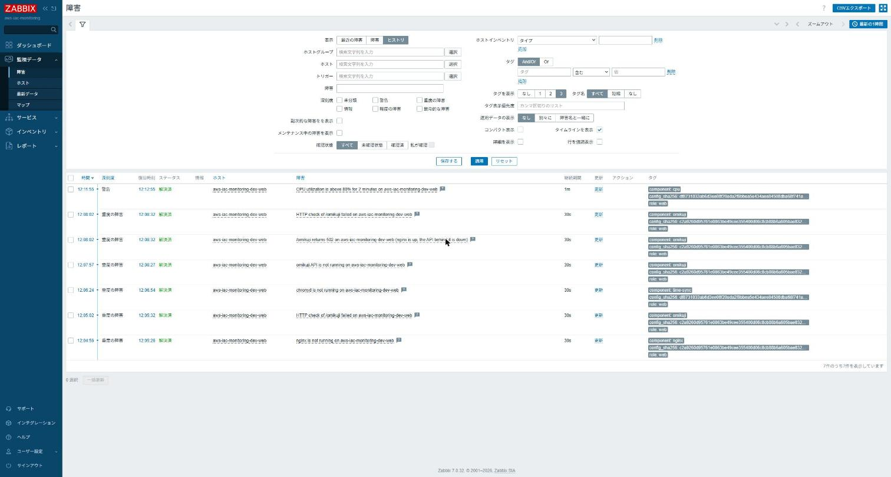
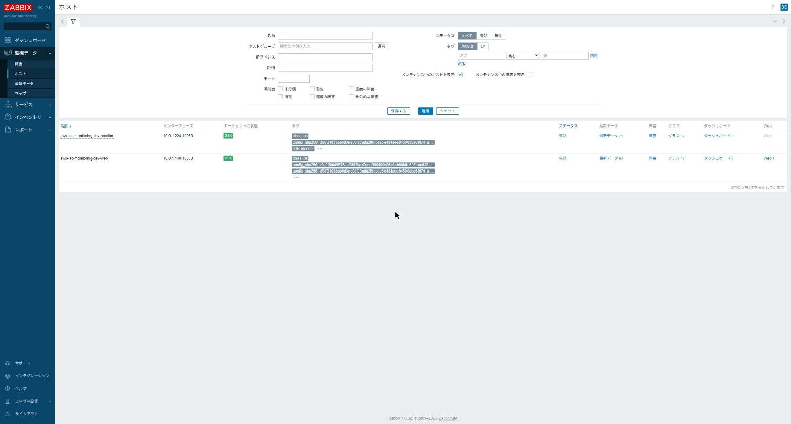
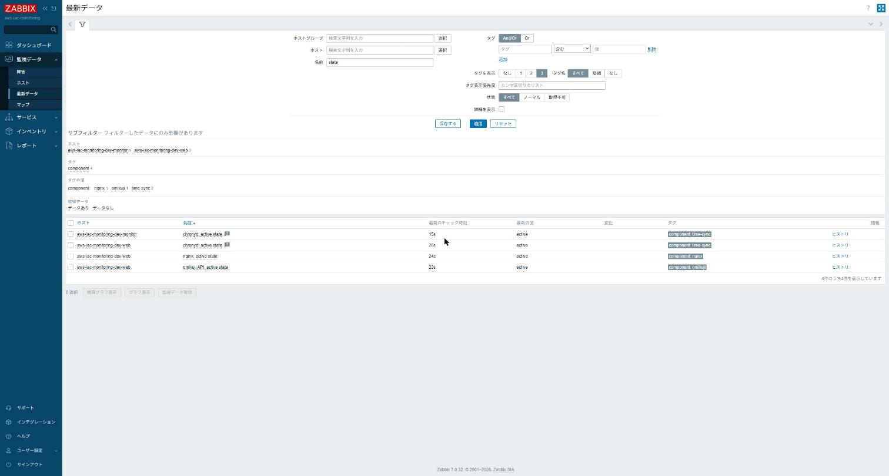

# 障害注入テスト

監視が「実際に壊れたときに気づけるか」を確かめるために、わざと障害を起こしたテストの記録。
実施日は 2026-11-27。対象は dev 環境の web サーバー（t3.micro、Amazon Linux 2023）。

- 手順はすべてスクリプトにしてある（`scripts/fault-injection/`）。
- 時刻の記録は `docs/evidence/*.json` にある。この文書の数値は、その記録と CloudWatch のアラーム履歴から取った。
- 個人の学習・検証用の環境での結果であり、本番運用の実績ではない。

## 結果のまとめ

4種類とも、期待したアラートが発報し、復旧させると解消した。出てはいけないアラートは出なかった。

| # | 注入した障害 | 検知したアラート | 注入から検知まで | 復旧から解消まで | 結果 |
|---|---|---|---|---|---|
| 1 | nginx を止める | Zabbix: nginx is not running | 11 秒 | 約 20 秒 | PASS |
| | | Zabbix: HTTP check of /omikuji failed | 17 秒 | 約 25 秒 | |
| 2 | chronyd を止める | Zabbix: chronyd is not running | 数秒（下の注記） | 約 25 秒 | PASS |
| 3 | CPU に負荷をかける | Zabbix: CPU utilization is above 80% for 2 minutes | 128 秒 | 約 55 秒 | PASS |
| | | CloudWatch: web-cpu-high が ALARM | 約 118 秒 | 約 99 秒 | |
| 4 | おみくじ API を止める | Zabbix: omikuji API is not running | 9 秒 | 約 25 秒 | PASS |
| | | Zabbix: /omikuji returns 502 (nginx is up, the API behind it is down) | 14 秒 | 約 30 秒 | |
| | | Zabbix: HTTP check of /omikuji failed | 14 秒 | 約 30 秒 | |

### 数値の読み方（注記）

- **時間は目安。** 注入の時刻は「SSM 経由のコマンドが終わったことを確認できた時点」で記録している。実際にサービスが止まったのは、その数秒前。そのため「注入から検知まで」は、実際より数秒短く出ている。
- **chronyd の「数秒」** は、記録上は 0 秒になっている。上の理由に加えて、たまたま値を取るタイミングの直前に止まったため。値を取る間隔は 30 秒なので、検知までの時間は最大で 30 秒程度になる。
- **解消までの時間** は、5 秒おきに確認した結果なので、5 秒の幅がある。
- **各テストは1回ずつ** しか実施していない。ばらつきは測っていない。

## 分かったこと

### 1. 障害の場所を切り分けられる

nginx とおみくじ API を別々のサービスにして、それぞれの稼働と HTTP の応答を監視した。その結果、同じ「/omikuji が見られない」という症状でも、アラートの組み合わせで原因を切り分けられた。

| 起きたこと | nginx のアラート | API のアラート | HTTP 502 のアラート | HTTP 監視のアラート |
|---|---|---|---|---|
| nginx が止まった（テスト1） | 発報 | なし | なし | 発報 |
| API だけが止まった（テスト4） | なし | 発報 | 発報 | 発報 |

テスト4では、nginx は動いたままなので nginx のアラートは出ず、「nginx は動いているが、裏の API が止まっている」という件名のアラートが出た。

### 2. Zabbix と CloudWatch の役割分担は、設計どおりだった

| テスト | Zabbix | CloudWatch |
|---|---|---|
| 1. nginx 停止 | 検知した | 検知しない |
| 2. chronyd 停止 | 検知した | 検知しない |
| 3. CPU 負荷 | 検知した | 検知した |
| 4. おみくじ API 停止 | 検知した | 検知しない |

サービスやプロセスの停止は OS の中の出来事なので、CloudWatch の標準のメトリクスでは分からない。Zabbix が受け持つ。CloudWatch は、EC2 を外から見られるので、Zabbix サーバー自身が止まった場合や OS が応答しない場合に役立つ（ステータスチェックのアラーム。今回のテストでは発報させていない）。

### 3. CloudWatch の検知は、予想より早かった

設計の時点では「CloudWatch は 5 分間隔の値を使うので、Zabbix より遅い」と考えていた。実際には、CPU 負荷を CloudWatch は約 118 秒、Zabbix は 128 秒で検知し、ほぼ同じだった。

- CloudWatch のアラーム履歴では、12:11:38 に ALARM、12:13:38 に OK になっていた。
- EC2 の基本モニタリングは 5 分に 1 回しか値を送らない。今回は、負荷をかけ始めてから約 2 分後に、たまたまその 1 回が来た。
- 値が来るタイミングしだいで、検知は 1 分後にも 6 分後にもなりうる。**今回の 118 秒は「運が良かった場合」の値で、最悪の場合は 5〜6 分かかる。**
- Zabbix の 128 秒は、「2 分間の平均が 80% を超えたら」という条件にしているため。こちらは毎回ほぼ同じ時間になる。

1回のテストの結果だけで「CloudWatch も早い」とは言えない。

## スクリーンショット

障害の履歴（Zabbix の「監視データ → 障害 → ヒストリ」）。4種類のテストで出た 7 件のアラートが、すべて「解決済」になっている。



監視対象のホスト。2台ともエージェント（ZBX）が緑で、利用可能になっている。



サービスの稼働状態の最新の値。



## 通知

アラートは、Zabbix と CloudWatch のどちらも、同じ SNS トピックからメールで届く。テストの間に届いたメールの件名は次のとおり。

- `[Zabbix] PROBLEM: nginx is not running on aws-iac-monitoring-dev-web` / `[Zabbix] RESOLVED: ...`
- `[Zabbix] PROBLEM: HTTP check of /omikuji failed on aws-iac-monitoring-dev-web` / `RESOLVED`
- `[Zabbix] PROBLEM: chronyd is not running on aws-iac-monitoring-dev-web` / `RESOLVED`
- `[Zabbix] PROBLEM: omikuji API is not running on aws-iac-monitoring-dev-web` / `RESOLVED`
- `[Zabbix] PROBLEM: /omikuji returns 502 on aws-iac-monitoring-dev-web (nginx is up, the API behind it is down)` / `RESOLVED`
- `[Zabbix] PROBLEM: CPU utilization is above 80% for 2 minutes on aws-iac-monitoring-dev-web` / `RESOLVED`
- `ALARM: "aws-iac-monitoring-dev-web-cpu-high" in Asia Pacific (Tokyo)` / `OK: ...`

発報と復旧の両方が届くことを、受信箱で確認した。

## 手順（再現する方法）

前提: dev 環境を apply して、`ansible-playbook site.yml` と `scripts/dev/zabbix-config.sh` を実行済みであること。SNS のメールの購読を確認済みであること。

```bash
# 通知の経路の確認（テスト通知が1通届く）
bash scripts/dev/sns-test.sh

# 短時間で終わる3種類（nginx-stop、chronyd-stop、omikuji-stop）を続けて実行
bash scripts/fault-injection/run-all.sh

# CPU 負荷（CloudWatch の検知と解消を待つので、数分〜20分かかる）
bash scripts/fault-injection/run-all.sh cpu-load

# 1つだけ実行する場合
bash scripts/fault-injection/run.sh nginx-stop
```

1つのテストは、次の順に進む。

1. 発生中の障害が 0 件であることを確かめる（残っていれば中止する）。
2. web サーバーに障害を注入する（SSM 経由）。
3. 期待するアラートが出るまで待ち、時刻を記録する。出てはいけないアラートが出ていないかも見る。
4. 復旧させる。
5. アラートが解消するまで待ち、時刻を記録する。
6. 記録を `docs/evidence/<テスト名>.json` に保存する。

注入と復旧に使うコマンドは次のとおり。

| テスト | 注入 | 復旧 |
|---|---|---|
| nginx-stop | `systemctl stop nginx` | `systemctl start nginx` |
| chronyd-stop | `systemctl stop chronyd` | `systemctl start chronyd` |
| omikuji-stop | `systemctl stop omikuji` | `systemctl start omikuji` |
| cpu-load | CPU の数だけ空回りのループを動かす（`systemd-run`、止め忘れても 20 分で自動終了） | `systemctl stop fault-cpu-load` |

CPU クレジットは standard にしてあるので、負荷をかけても追加料金は出ない。

## 実施していないこと

- EC2 を止める・再起動するテスト（ステータスチェックのアラームと、Zabbix の「エージェントに届かない」の確認）
- 監視サーバー自身を止めるテスト（CloudWatch だけが検知する、という想定の確認）
- ディスクやメモリを使い切るテスト
- 同じテストの繰り返し（検知までの時間のばらつきの測定）
